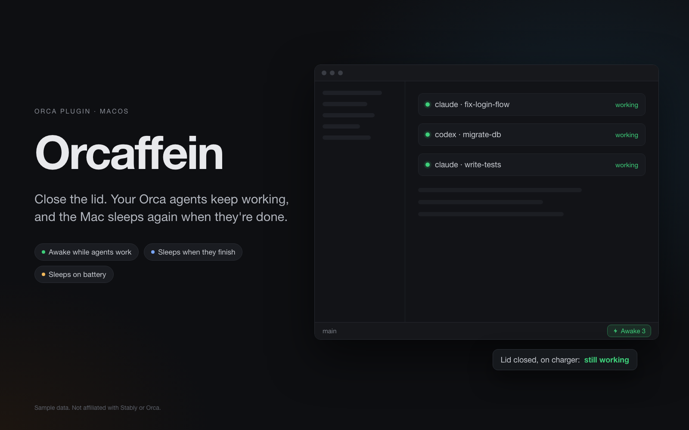
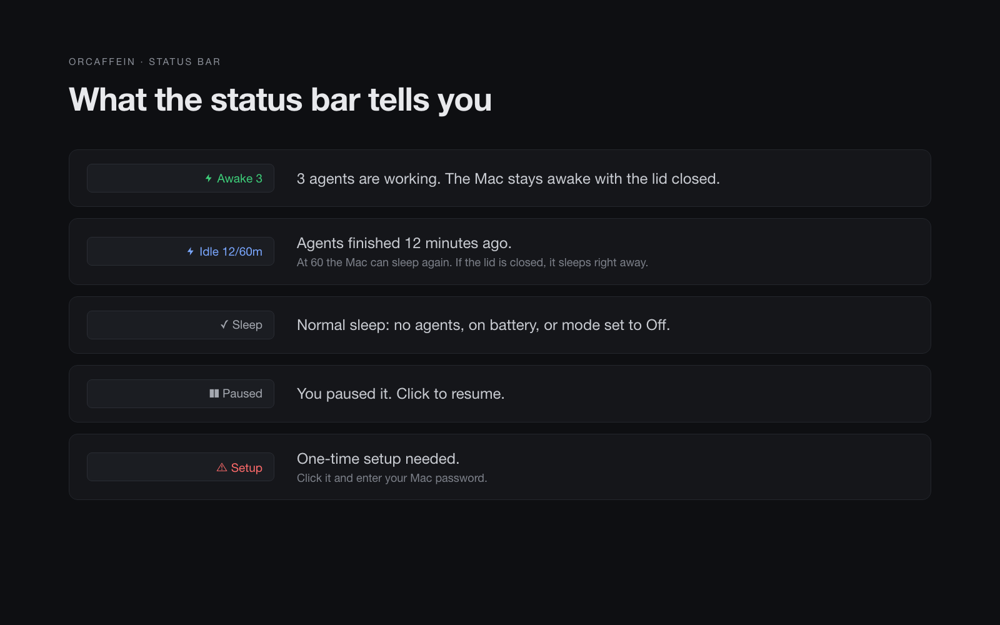

# Orcaffein

Close your MacBook and your [Orca](https://github.com/stablyai/orca) agents keep working.



## Why

You start a few long agent runs, close the laptop and walk away. macOS puts the Mac to sleep and
the agents stop halfway. Orca's own "Keep computer awake" setting doesn't help: it only works with
the lid open.

Orcaffein keeps the Mac awake with the lid closed for as long as an agent is working, then lets it
sleep again.

## What you get

- The Mac stays awake, lid closed, while any Orca agent is working, in any workspace.
- The built-in screen turns off under the lid, so it doesn't burn battery or heat up.
- When the agents finish, the Mac waits 60 minutes, then sleeps normally. Right away if the lid
  is closed.
- Unplug the charger and the Mac goes back to normal sleep at once.
- A status bar item shows what's going on. Click it to pause.



## Install

1. In Orca, open Settings → Plugins, choose Add plugin, then From a Git URL…
2. Paste `https://github.com/canhta/orcaffein` and choose Install. Review the access it asks for
   and enable it.
3. Click `Setup` in the status bar and enter your Mac password. You only do this once.

Requires macOS and Orca 1.4.248 or newer.

## What the password is for

macOS only lets an administrator stop lid-close sleep. Setup adds one rule to
`/etc/sudoers.d/orcaffein` that lets Orcaffein run exactly these commands without asking again:

```
pmset -a disablesleep 0
pmset -a disablesleep 1
pmset sleepnow
```

Nothing else. Orcaffein never sees your password, makes no network requests and collects nothing.
Prefer a terminal? Run `scripts/install-sudoers.sh` from a clone of this repo instead.

## Good to know

- Leave the Mac on a desk, not in a bag. A closed laptop doing work still gets warm.
- In Orcaffein's settings (Settings → Plugins) you can change the 60 minutes, allow battery use, or switch
  the mode to On (awake whenever plugged in) or Off.
- If the Mac crashes or loses power while kept awake, lid-close sleep stays off until you open
  Orca again, or run `sudo pmset -a disablesleep 0`.

## Uninstall

Remove it in Settings → Plugins, then in a terminal:

```sh
sudo pmset -a disablesleep 0
sudo rm /etc/sudoers.d/orcaffein
```

## Support

Open an [issue](https://github.com/canhta/orcaffein/issues). Independent project, not affiliated
with Stably or Orca. MIT license.
